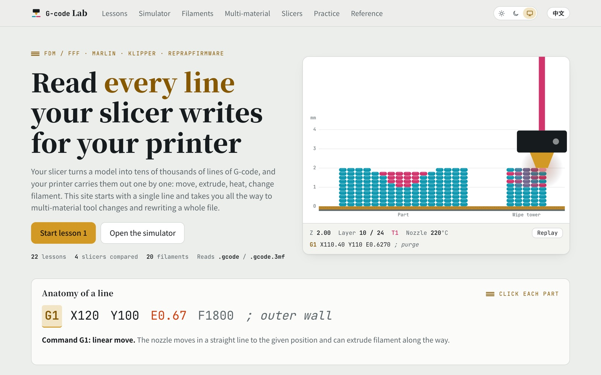
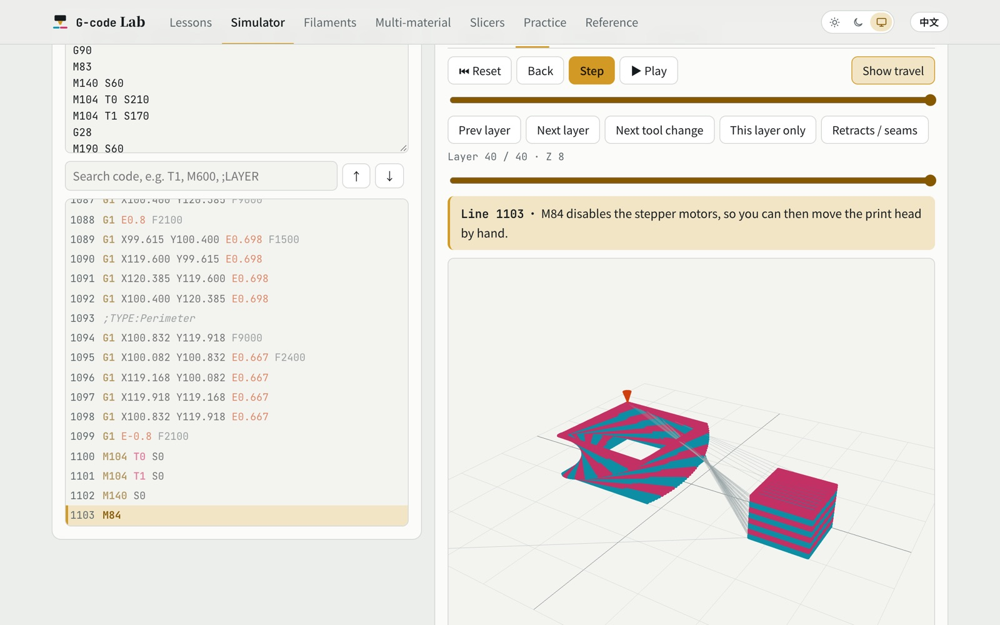
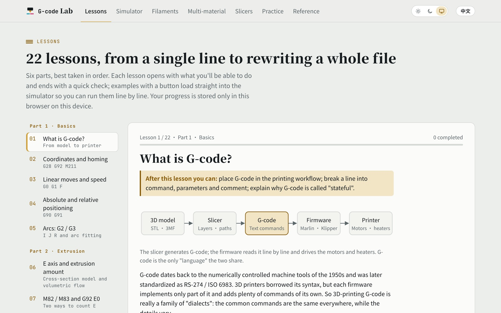
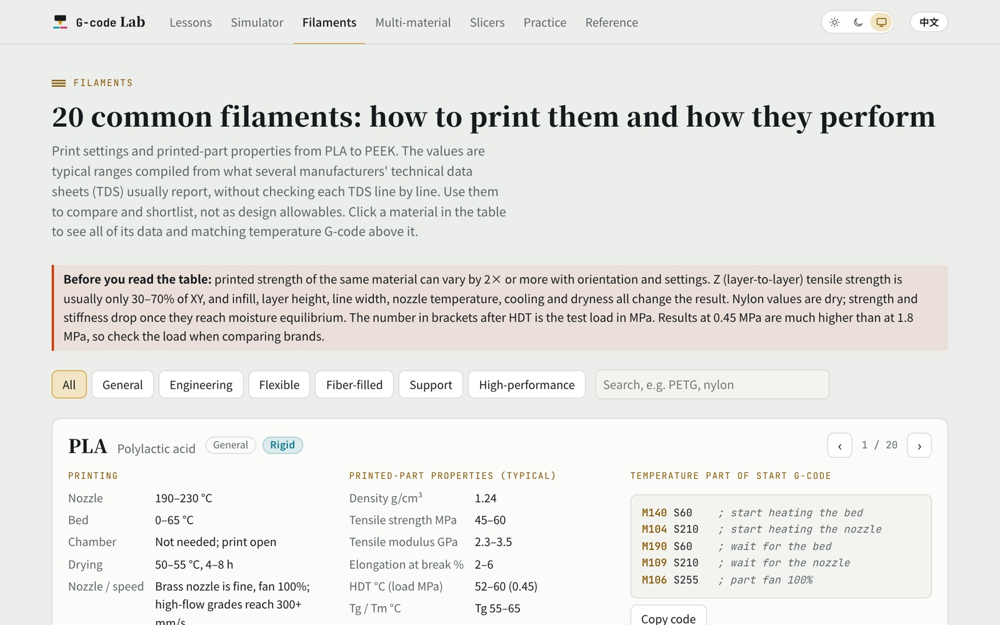

<div align="center">

[简体中文](README.md) · **English**

# G-code Lab · GcodeLAB

**Read every line your slicer writes for your 3D printer**

Interactive lessons + an online G-code simulator + a filament handbook. Runs in the browser, nothing to install.

[](https://waterfa258.github.io/GcodeLAB/#en)
[](https://waterfa258.github.io/GcodeLAB/)

</div>

<picture>
  <source media="(prefers-color-scheme: dark)" srcset="docs/screenshots/en/home-dark.jpg">
  
</picture>

## What is this?

Your slicer (PrusaSlicer, Bambu Studio, Cura…) turns a model into tens of thousands of lines of G-code, and your printer carries them out one by one. This site helps you read that code: it starts with a single line like `G1 X120 E0.67` and works through extrusion, temperature and retraction, all the way to multi-material tool changes and rewriting a whole file.

Made for FDM users who want to know what their printer is actually doing, anyone editing start or tool-change G-code, people tuning multi-color prints, and teachers of 3D printing.

## Jump straight in

Click a name to open that page:

- 📘 **[Lessons](https://waterfa258.github.io/GcodeLAB/#en-lessons)**: 22 lessons in six parts: basics, extrusion, temperature, reading slicer output, multi-material and advanced. Each has diagrams, common mistakes and a quick check
- ▶️ **[Simulator](https://waterfa258.github.io/GcodeLAB/#en-sim)**: step through G-code and watch the path in top view or 3D; open your own `.gcode` or `.gcode.3mf`; file analysis and code check
- 🧵 **[Filaments](https://waterfa258.github.io/GcodeLAB/#en-materials)**: print temperatures, drying and properties for 20 common filaments, with temperature G-code and a multi-material bonding chart
- 🎨 **[Multi-material](https://waterfa258.github.io/GcodeLAB/#en-mm)**: one tool change taken apart line by line: purge, ooze, standby temperature and tool offset
- 🔧 **[Slicers](https://waterfa258.github.io/GcodeLAB/#en-slicers)**: how PrusaSlicer, OrcaSlicer / Bambu Studio, Cura and Klipper macros write it, side by side
- ✅ **[Practice](https://waterfa258.github.io/GcodeLAB/#en-practice)**: write your own code; the page runs it and grades each check. Plus multiple-choice questions
- 📋 **[Reference](https://waterfa258.github.io/GcodeLAB/#en-ref)**: what common commands do, with examples and Marlin / Klipper / RepRapFirmware support. Searchable

New here? Try **Lessons → Simulator → Practice**.

## A quick look

<table>
<tr>
<td width="50%" valign="top">
<b>Simulator</b>: run line by line, see a two-color tower and its wipe tower in 3D, with live position, temperatures and active tool
<picture>
  <source media="(prefers-color-scheme: dark)" srcset="docs/screenshots/en/sim-dark.jpg">
  
</picture>
</td>
<td width="50%" valign="top">
<b>Lessons</b>: each one opens with what you'll be able to do, with diagrams and a quick check
<picture>
  <source media="(prefers-color-scheme: dark)" srcset="docs/screenshots/en/lessons-dark.jpg">
  
</picture>
</td>
</tr>
<tr>
<td width="50%" valign="top">
<b>Filaments</b>: from PLA to PEEK, print settings, properties and matching temperature G-code
<picture>
  <source media="(prefers-color-scheme: dark)" srcset="docs/screenshots/en/materials-dark.jpg">
  
</picture>
</td>
<td width="50%" valign="top">
<b>Also</b>
<ul>
<li>Switch between Chinese and English in one click</li>
<li>Light, dark or match your system</li>
<li>Works on phones</li>
<li>G-code files you open are parsed in your own browser and <b>never uploaded</b></li>
<li>Progress is saved on your device</li>
<li>No Google Fonts or CDNs: every file loads from the site itself</li>
</ul>
</td>
</tr>
</table>

## Run it locally

The whole site is a single `index.html` with no install or build step. Download the repo and double-click `index.html` to use it offline, or start a local server:

```bash
git clone https://github.com/Waterfa258/GcodeLAB.git
cd GcodeLAB
python3 -m http.server 8000
```

Then open <http://localhost:8000>.

## Project layout

```
index.html          the whole site (both languages, styles and scripts)
vendor/fonts/       fonts trimmed to the characters the page uses, plus the script that regenerates them
vendor/three/       three.js r128, loaded only when you open the 3D view
docs/screenshots/   screenshots for these READMEs
```

Everything ships with the site; nothing is fetched from Google Fonts or a CDN. If you change the page text (especially new Chinese characters), regenerate the fonts as described in [vendor/fonts/README.md](vendor/fonts/README.md) (in Chinese; it's a single `uv run` command).

## Notes

- Lessons and the reference focus on Marlin, Klipper and RepRapFirmware. Details vary between firmware and slicer versions, so check the official docs before running anything on a real printer.
- Filament data are typical ranges compiled from several manufacturers' technical data sheets (TDS). Use them to compare and shortlist, not as design allowables.
- Third-party licenses: three.js (MIT, see `vendor/three/LICENSE`); Noto Sans SC / Noto Serif SC / JetBrains Mono (SIL OFL 1.1, see `vendor/fonts/`).

Found a mistake or have a suggestion? Please open an [issue](https://github.com/Waterfa258/GcodeLAB/issues).
