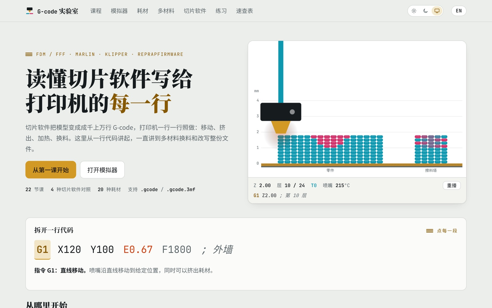
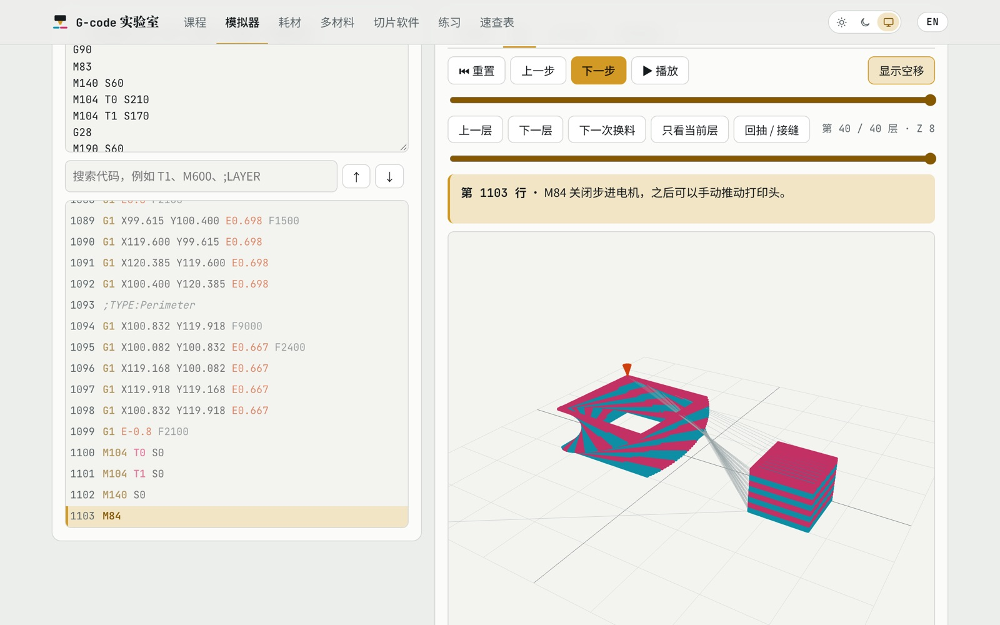
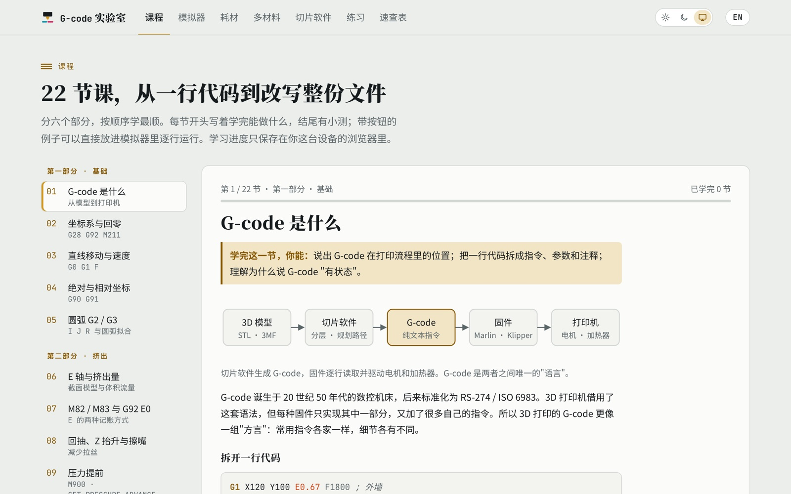
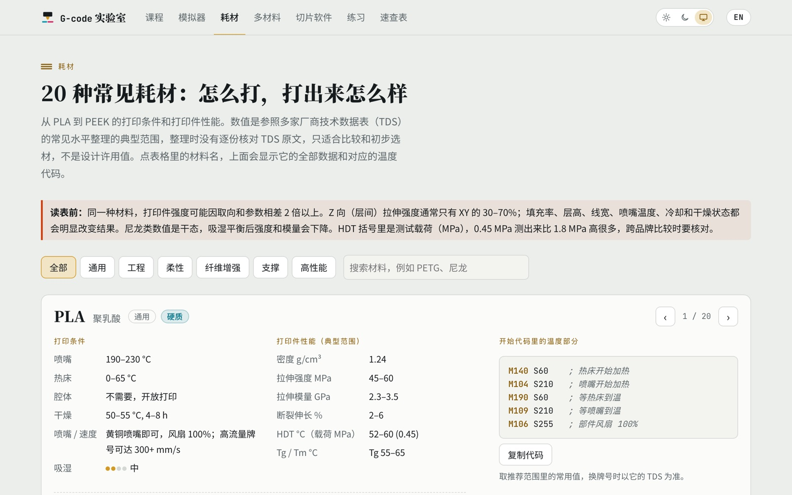

<div align="center">

**简体中文** · [English](README.en.md)

# G-code 实验室 · GcodeLAB

**读懂切片软件写给 3D 打印机的每一行 G-code**

交互式课程 + 在线 G-code 模拟器 + 耗材手册，打开网页就能用，不用安装

[](https://waterfa258.github.io/GcodeLAB/)
[](https://waterfa258.github.io/GcodeLAB/#en)

</div>

<picture>
  <source media="(prefers-color-scheme: dark)" srcset="docs/screenshots/home-dark.jpg">
  
</picture>

## 这是什么

切片软件（PrusaSlicer、Bambu Studio、Cura……）把模型变成成千上万行 G-code，打印机一行一行照做。这个网站帮你看懂这些代码：从一行 `G1 X120 E0.67` 讲起，到挤出、温度、回抽，一直到多材料换料和改写整份文件。

适合：想弄明白打印机在做什么的 FDM 用户、想改开始 / 换料代码的人、调多色打印的人，以及教 3D 打印的老师。

## 直接进入

点名称直接打开对应页面：

- 📘 **[课程](https://waterfa258.github.io/GcodeLAB/#lessons)**：22 节课，分六部分：基础、挤出、温度、读懂切片文件、多材料、进阶。每节有图示、常见错误和小测 <sub>[English](https://waterfa258.github.io/GcodeLAB/#en-lessons)</sub>
- ▶️ **[模拟器](https://waterfa258.github.io/GcodeLAB/#sim)**：逐行运行 G-code，俯视图 / 3D 看路径；打开自己的 `.gcode`、`.gcode.3mf`；文件分析和代码检查 <sub>[English](https://waterfa258.github.io/GcodeLAB/#en-sim)</sub>
- 🧵 **[耗材](https://waterfa258.github.io/GcodeLAB/#materials)**：20 种常见耗材的打印温度、干燥、性能对比，附温度代码和多材料结合表 <sub>[English](https://waterfa258.github.io/GcodeLAB/#en-materials)</sub>
- 🎨 **[多材料](https://waterfa258.github.io/GcodeLAB/#mm)**：逐行拆解一次换料：冲刷、渗料、待机温度、喷头偏移 <sub>[English](https://waterfa258.github.io/GcodeLAB/#en-mm)</sub>
- 🔧 **[切片软件](https://waterfa258.github.io/GcodeLAB/#slicers)**：PrusaSlicer、OrcaSlicer / Bambu Studio、Cura、Klipper 宏的写法对照 <sub>[English](https://waterfa258.github.io/GcodeLAB/#en-slicers)</sub>
- ✅ **[练习](https://waterfa258.github.io/GcodeLAB/#practice)**：自己写代码，网页执行后逐条判分；另有选择题 <sub>[English](https://waterfa258.github.io/GcodeLAB/#en-practice)</sub>
- 📋 **[速查表](https://waterfa258.github.io/GcodeLAB/#ref)**：常用指令的作用、示例和 Marlin / Klipper / RepRapFirmware 支持情况，可搜索 <sub>[English](https://waterfa258.github.io/GcodeLAB/#en-ref)</sub>

第一次来，建议按 **课程 → 模拟器 → 练习** 的顺序。

## 看一眼

<table>
<tr>
<td width="50%" valign="top">
<b>模拟器</b>：逐行执行，3D 里看双色小塔和擦料塔，右侧实时显示坐标、温度、当前工具
<picture>
  <source media="(prefers-color-scheme: dark)" srcset="docs/screenshots/sim-dark.jpg">
  
</picture>
</td>
<td width="50%" valign="top">
<b>课程</b>：每节开头写清学完能做什么，配图示和小测
<picture>
  <source media="(prefers-color-scheme: dark)" srcset="docs/screenshots/lessons-dark.jpg">
  
</picture>
</td>
</tr>
<tr>
<td width="50%" valign="top">
<b>耗材</b>：从 PLA 到 PEEK，打印条件、性能和对应的温度代码
<picture>
  <source media="(prefers-color-scheme: dark)" srcset="docs/screenshots/materials-dark.jpg">
  
</picture>
</td>
<td width="50%" valign="top">
<b>其他特点</b>
<ul>
<li>中文 / English 一键切换</li>
<li>亮色 / 暗色 / 跟随系统</li>
<li>手机上也能用</li>
<li>你打开的 G-code 文件只在自己的浏览器里解析，<b>不会上传</b></li>
<li>学习进度保存在本机</li>
<li>不依赖 Google Fonts、CDN 等外部服务，所有文件都从本站加载</li>
</ul>
</td>
</tr>
</table>

## 在本地运行

整个网站就是一个 `index.html`，不需要安装和构建。下载仓库后直接双击 `index.html` 就能离线使用，或者起一个本地服务器：

```bash
git clone https://github.com/Waterfa258/GcodeLAB.git
cd GcodeLAB
python3 -m http.server 8000
```

然后打开 <http://localhost:8000>。

## 项目结构

```
index.html          整个网站（中英文、样式、脚本都在里面）
vendor/fonts/       按页面用字裁剪的字体 + 重新生成脚本
vendor/three/       three.js r128，只在打开 3D 视图时加载
docs/screenshots/   本 README 用的截图
```

所有文件都随站点一起发布，不请求 Google Fonts 或 CDN。改了网页文字（尤其是加了新的中文字）之后，要重新生成字体，方法见 [vendor/fonts/README.md](vendor/fonts/README.md)。

## 说明

- 课程和速查表以 Marlin、Klipper、RepRapFirmware 为主。不同固件和切片软件版本的细节可能不同，真正上机前请对照官方文档。
- 耗材数据是参照多家厂商技术数据表（TDS）整理的典型范围，适合比较和初步选材，不是设计许用值。
- 第三方组件的许可：three.js（MIT，见 `vendor/three/LICENSE`），Noto Sans SC / Noto Serif SC / JetBrains Mono（SIL OFL 1.1，见 `vendor/fonts/`）。

发现错误或有建议，欢迎提 [Issue](https://github.com/Waterfa258/GcodeLAB/issues)。
